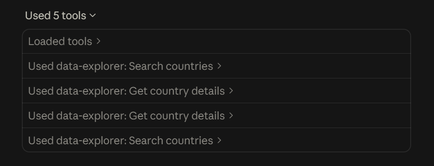
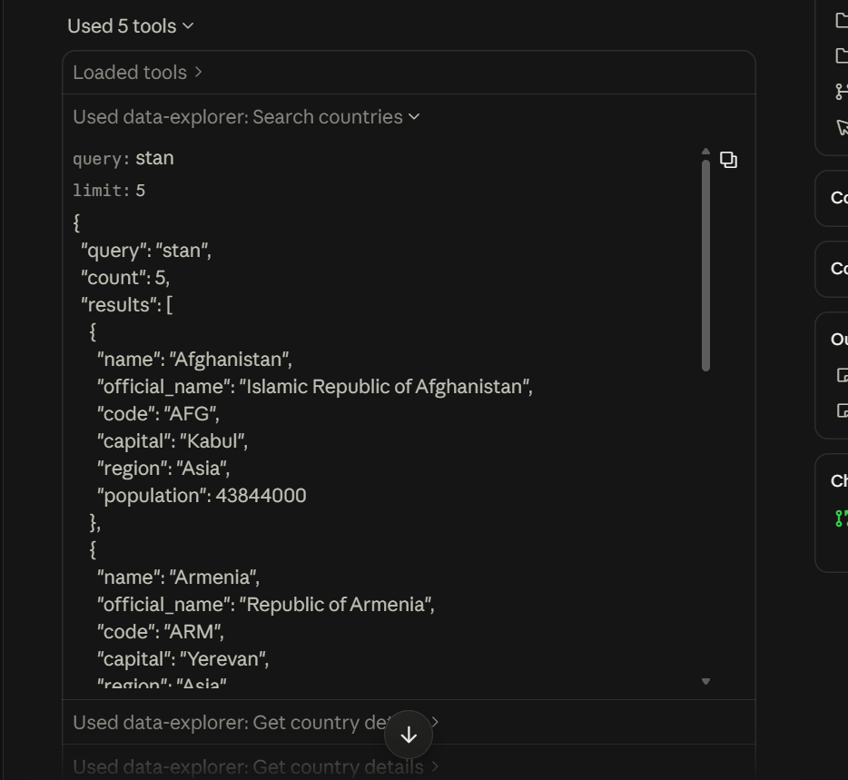

# Week 4 writeup: the Data Explorer MCP server

## What I built

`server.py` is a FastMCP server over STDIO with two read-only tools: the starter's
`search_countries` (hardened) and my `get_country_details`, which returns currencies,
languages, borders with their names, and the flag (emoji, PNG, SVG, description).

The starter didn't run as given, for two reasons:

- REST Countries took down `/v3.1` and every older version. Calls now get a 301 to a JSON file
  that says the version is deprecated. The new `/v5` API has a different response shape
  (`data.objects`, `names.common`, `capitals[].name`, `flag.url_png`) and needs an API key, so
  I moved the server to v5 and read the key from `RESTCOUNTRIES_API_KEY` or a local `.env`.
- `requirements.txt` had an unpinned `mcp`. A fresh install pulls 2.x, where `FastMCP` was
  renamed to `MCPServer` and the import fails. I pinned `mcp==1.30.0` and `httpx==0.28.1`.

## Registered in Claude Desktop

I added the server to `claude_desktop_config.json` (the `mcpServers` block from the README,
pointing at the project's venv Python and `server.py`; the key stays in `.env`) and restarted
Claude Desktop. Its tools then showed up as `mcp__data-explorer__search_countries` and
`mcp__data-explorer__get_country_details`, and Claude called them like this (results shortened):

```text
search_countries(query="stan", limit=5)
-> {"query": "stan", "count": 5, "results": [Afghanistan (Kabul), Armenia (Yerevan),
    Kazakhstan (Astana), Kyrgyzstan (Bishkek), Pakistan (Islamabad)]}

get_country_details(name="Turkey")
-> {"name": "Turkey", "capital": "Ankara",
    "currencies": [{"code": "TRY", "name": "Turkish lira", "symbol": "₺"}],
    "languages": [{"code": "tr", "name": "Turkish", "native_name": "Türkçe"}],
    "borders": [Armenia, Azerbaijan, Bulgaria, Georgia, Greece, Iran, Iraq, Syria],
    "flag": {"emoji": "🇹🇷", "png": "https://flags.restcountries.com/v5/w640/tr.png", ...}}

get_country_details(name="Guine")
-> {"error": {"code": "ambiguous", "message": "'Guine' matches 4 countries; ask which one is meant",
    "candidates": ["Equatorial Guinea", "Guinea", "Guinea-Bissau", "Papua New Guinea"]}}

search_countries(query="  ")
-> {"error": {"code": "invalid_input", "message": "query must not be empty"}}
```

The four calls as Claude Desktop shows them, and the first one opened:





## Agent transcripts

I also drove the server with `agent_demo.py`. It starts `server.py` over STDIO with the official MCP
Python client, gives the server's tool list to a local model (gpt-oss:20b on Ollama) and runs
whatever tool calls the model makes. The tool results below are shortened.

**search_countries**

```text
[mcp] connected, tools: search_countries, get_country_details
[user] Which countries have 'stan' in their name? Give me the first five with their capitals.
[tool call] search_countries({"limit": 5, "query": "stan"})
[tool result] {"query": "stan", "count": 5, "results": [
  {"name": "Afghanistan", "capital": "Kabul", ...}, {"name": "Armenia", "capital": "Yerevan", ...},
  {"name": "Kazakhstan", "capital": "Astana", ...}, ...]}
[agent] The first five countries that contain "stan" in their name, along with their capitals, are:
| Afghanistan | Kabul | Armenia | Yerevan | Kazakhstan | Astana | Kyrgyzstan | Bishkek | Pakistan | Islamabad |
```

Armenia is in the list because the search also matches native names, and Armenia's is
Hayastan. The tool is right, but the agent's answer ("contain stan in their name") is a little
misleading. Next time I'd return which name matched.

**get_country_details, with a real timeout on the first try**

```text
[user] Which countries border Turkey, and what currency and language does it use?
[tool call] get_country_details({"name": "Turkey"})
[tool result] {"error": {"code": "timeout", "message": "REST Countries did not answer within 10 s; try again"}}
[tool call] get_country_details({"name": "Turkey"})
[tool result] {"name": "Turkey", "official_name": "Republic of Türkiye", "capital": "Ankara",
  "currencies": [{"code": "TRY", "name": "Turkish lira", "symbol": "₺"}],
  "languages": [{"code": "tr", "name": "Turkish", "native_name": "Türkçe"}],
  "borders": [{"code": "ARM", "name": "Armenia"}, {"code": "AZE", "name": "Azerbaijan"}, ...], ...}
[agent] Turkey shares borders with eight countries: Armenia, Azerbaijan, Bulgaria, Georgia,
Greece, Iran, Iraq and Syria. Currency: Turkish lira (TRY). Official language: Turkish (tr).
```

I didn't plan the timeout. The API was slow once, the tool returned a structured `timeout`
error instead of crashing, and the model read "try again" and called the tool a second time.

**A misspelled name (agent_demo.py)**

```text
[user] What is the currency of Guine?
[tool call] get_country_details({"name": "Guinea"})
[agent] The currency of Guinea is the Guinean franc (GNF).
```

The model fixed the spelling before calling the tool. Called directly, `get_country_details("Guine")`
returns `ambiguous` with the four candidates (Equatorial Guinea, Guinea, Guinea-Bissau,
Papua New Guinea), so an agent that passes the text through can ask which one was meant.

## How I handled errors

Both tools go through one `_get` helper and return `{"error": {"code", "message"}}` for every
problem, so the agent always gets something it can read:

- **Input**: empty or blank text, more than 100 characters, digits or symbols, the wrong type,
  and a `limit` outside 1 to 25 are rejected before any request. Real names with apostrophes,
  hyphens, commas and non-English letters still pass ("Côte d'Ivoire", "Åland Islands").
- **Network**: timeouts (10 s) and connection errors become `timeout` and `network_error`.
- **HTTP**: 400, 401, 403 (quota), 410, 429 (with `Retry-After`) and 5xx each get their own code.
  A 404 on an exact lookup means no match, not an error.
- **Bad data**: a body that isn't JSON or doesn't have `data.objects` becomes `bad_response`. The
  public demo key always returns Canada, so that gets its own `demo_key` error instead of being
  passed off as a real answer.
- **No results**: `search_countries` returns an empty list with a hint; `get_country_details`
  returns `not_found`, or `ambiguous` with the candidates.
- **Partial failure**: if the second request that turns border codes into names fails, the
  codes are still returned with `name: null`.

The free plan allows 1,000 requests a month and 20 per 10 seconds, so answers are cached for
10 minutes. 48 tests check these cases against a fake API, and one more test starts the server
over real STDIO and checks that bad input and a missing key come back as data.

## What I learned

The tool schema and the shape of the results decide what an agent can know and do. My
docstrings, parameter descriptions and return fields are all it sees, so I kept each tool to a
few fields an agent needs instead of passing through the API's 90 fields and translations.
Errors are context too: when the timeout came back as a clear message, the model retried on its
own, and the `ambiguous` candidates let an agent ask instead of guessing. The starter also showed
me how fragile reach is: two dependencies changed under it (the API version and the SDK), and
without pins and structured errors the agent would just have seen a crash.
